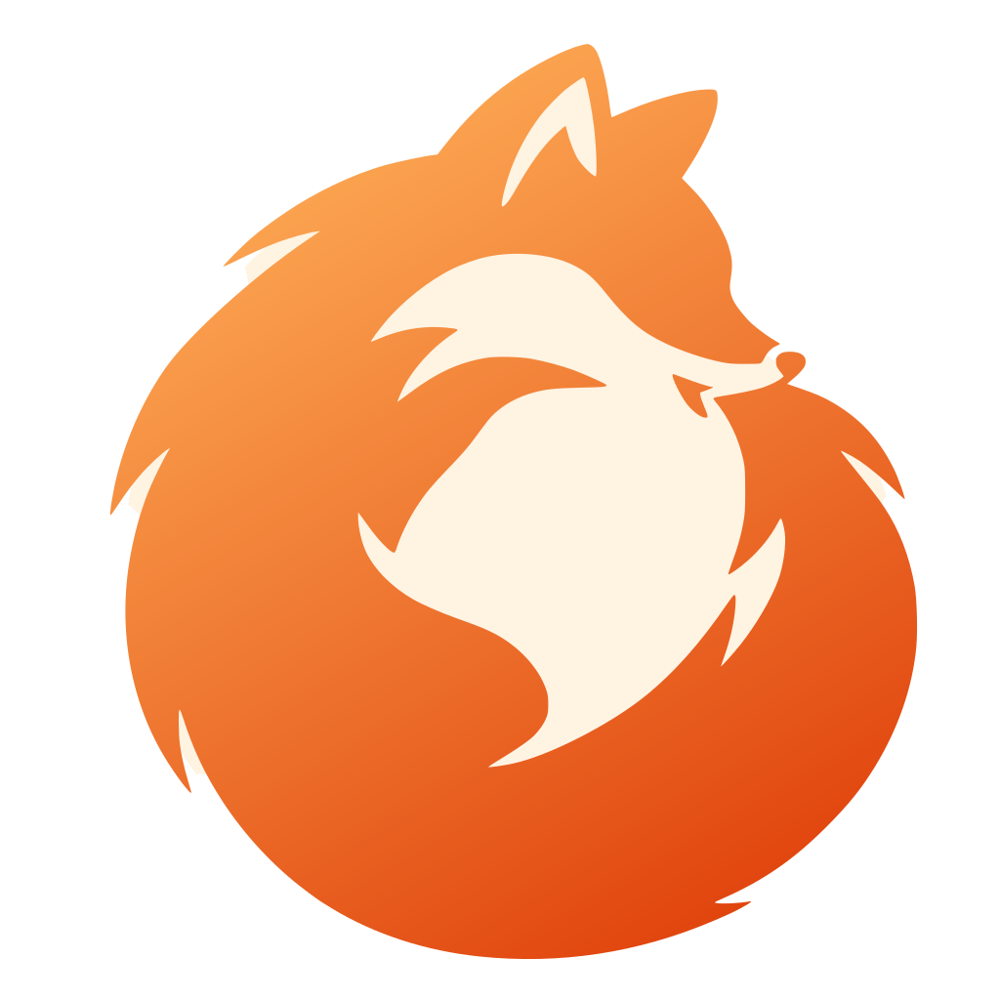
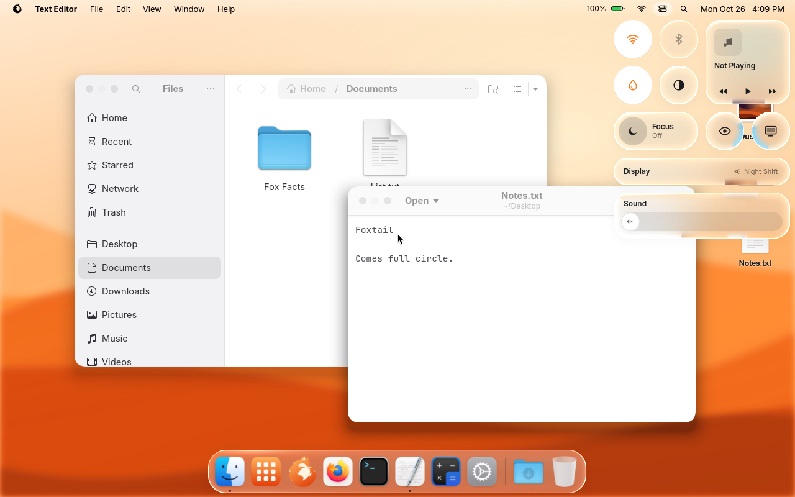
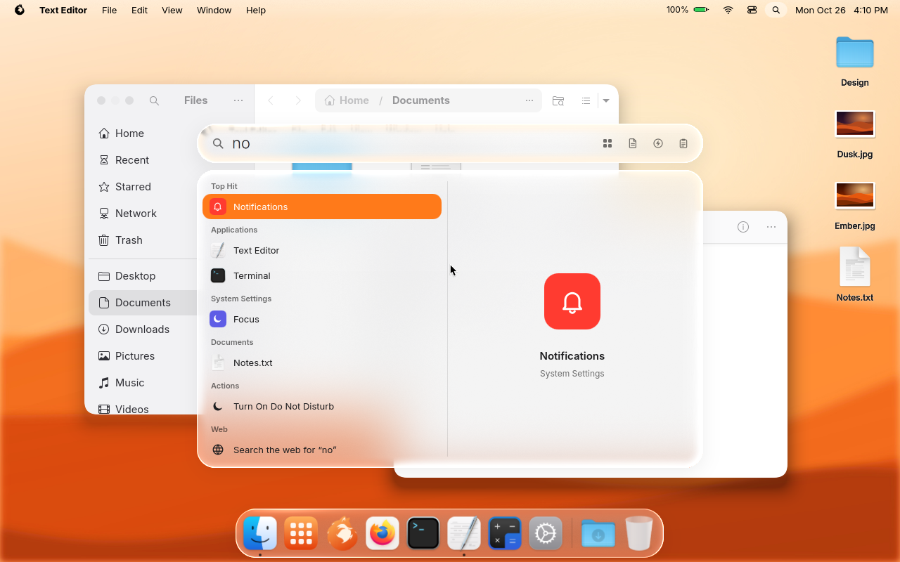
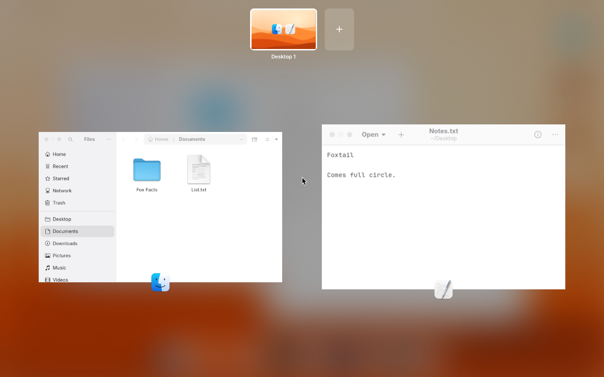
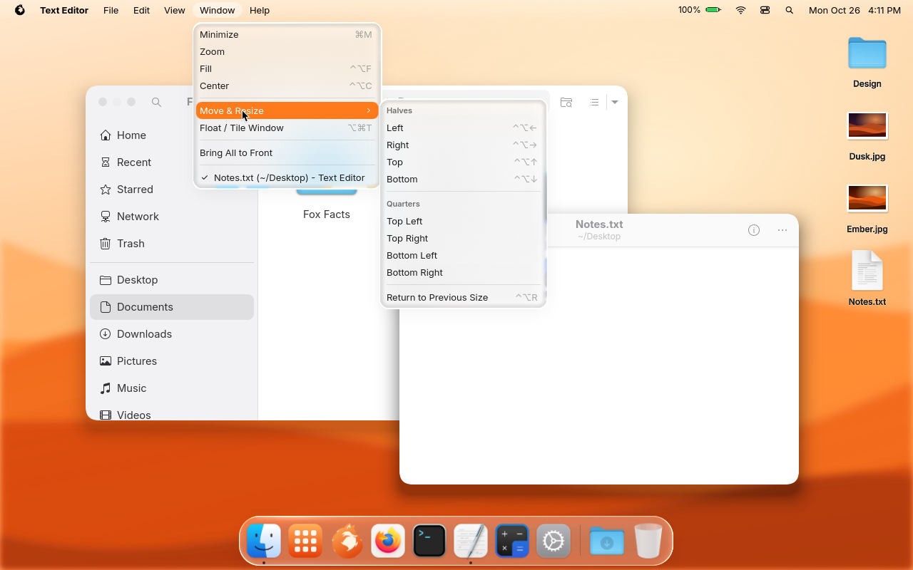
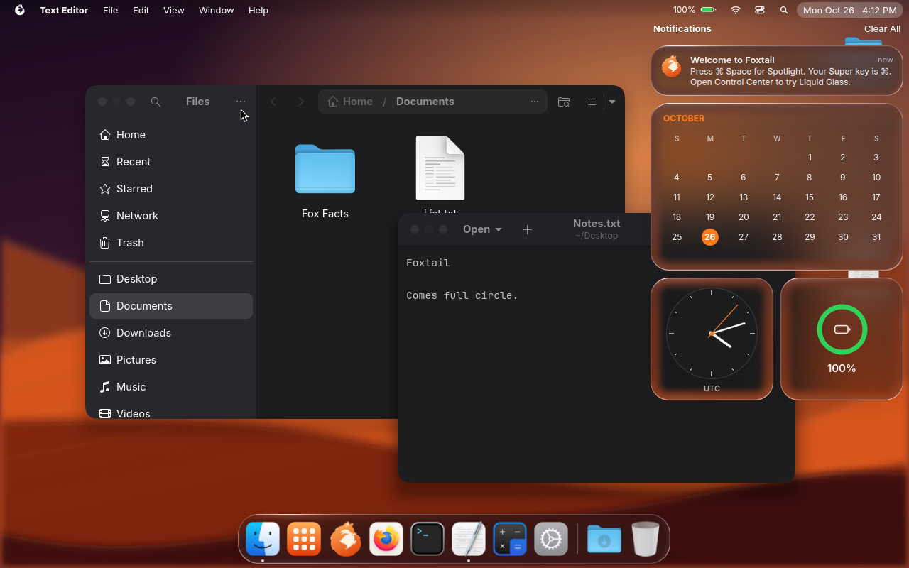
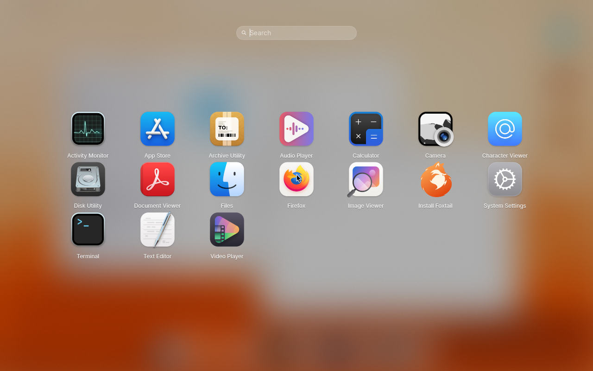
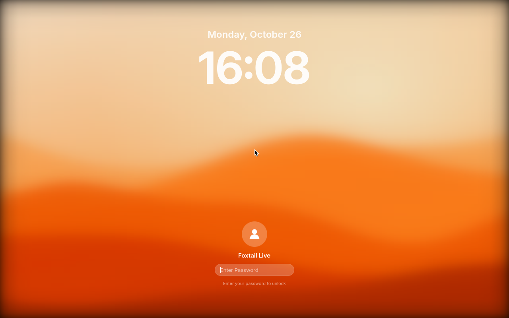

<div align="center">



# Foxtail

### Comes full circle.

A macOS-style desktop on Arch Linux: a hand-built shell, orange through and through, wrapped in **Liquid Glass**.

[](https://github.com/suhl2DOTxyz/foxtail/releases/latest)
[](https://archlinux.org)
[](https://hyprland.org)
[-41CD52?style=for-the-badge&logo=qt&logoColor=white)](https://quickshell.org)

[**Download**](https://github.com/suhl2DOTxyz/foxtail/releases/latest) · [Features](#features) · [Shortcuts](#shortcuts) · [Build it yourself](#build) · [Roadmap](ROADMAP.md)

<br>



</div>

<br>

## 🦊 What is Foxtail?

Foxtail is a Linux distribution that looks and behaves like a Mac, not just a Linux desktop painted to resemble one. The menu bar, Dock, Spotlight, Control Center, Mission Control and System Settings are all written from scratch in QML on top of [Hyprland](https://hyprland.org). Apps keep the shortcuts your fingers already know: ⌘C copies, ⌘Q quits, ⌘Tab switches apps.

It's Arch underneath, so you get current software, the AUR and Flatpak. On top, it's designed so that everyday things never need a terminal.

<br>

<a id="features"></a>

## ✨ Features

> *Clever by nature.*

<table>
<tr>
<td width="50%" valign="top">

### 💧 Liquid Glass
A material modelled on macOS Tahoe's: glass edges **bend what's behind them** like a real lens (Snell's law over a squircle bevel), clear at the rim and frosted in the middle, with a thin highlight that catches the light and a glow when you press it. The tint adapts so text stays readable over anything. Pick **Clear** or **Tinted**, or turn it off for classic frosted vibrancy.

</td>
<td width="50%" valign="top">

### 🔍 Spotlight
⌘Space for grouped results (Top Hit, Applications, System Settings, Folders, Documents, Actions), a live **preview pane**, a calculator, and buttons to browse Apps, Files, Actions and your **Clipboard history** without typing a thing.

</td>
</tr>
<tr>
<td valign="top">

### 🪟 Windows, the Mac way
Windows float and open centered. The traffic lights sit where you expect them, and the green one zooms. **Window ▸ Move & Resize** tiles to halves and quarters, ⌘H hides an app, ⌘M minimizes to the Dock, windows snap to edges, and F11 shows the desktop.

</td>
<td valign="top">

### 🖥️ Desktop & Dock
Files on your desktop with real thumbnails, drag-to-arrange and a right-click menu. A magnifying Dock with a **Downloads stack**, a Trash that fills up, notification badges and drag-to-reorder. Plus **Mission Control**, **⌘Tab**, **Launchpad** and **Hot Corners**.

</td>
</tr>
<tr>
<td valign="top">

### ⚙️ No terminal needed
System Settings covers Wi-Fi, Bluetooth, **Displays** (with "Keep these settings?"), Sound, Keyboard, Trackpad, Mouse, Users & Groups, Printers, Date & Time, Default Apps, Login Items and **Software Update**.

</td>
<td valign="top">

### 🛟 Safe updates
Foxtail updates from its own signed repository. Every update takes a **Btrfs snapshot** first, so a bad one can be rolled back from System Settings or straight from the boot menu.

</td>
</tr>
<tr>
<td valign="top">

### 📸 Screenshots & recording
⇧⌘3, ⇧⌘4 and the **⇧⌘5 toolbar**, with the little floating thumbnail. Screenshots land on your Desktop, and screen recordings get a stop button in the menu bar.

</td>
<td valign="top">

### 💻 Real hardware
A friendly installer with language and keyboard setup, **full-disk encryption** and installing **alongside Windows**. Laptop battery modes, NVIDIA support, and zram swap.

</td>
</tr>
</table>

<br>

## 🖼️ Gallery

> *Sly. Smooth. Yours.*

<table>
<tr>
<td><p align="center"><b>Spotlight</b>: grouped results and a preview</p></td>
<td><p align="center"><b>Mission Control</b>: every window, every desktop</p></td>
</tr>
<tr>
<td><p align="center"><b>Window tiling</b>: halves, quarters, Fill and Center</p></td>
<td><p align="center"><b>Dark mode</b>: the wallpaper follows along</p></td>
</tr>
<tr>
<td><p align="center"><b>Launchpad</b>: all your apps</p></td>
<td><p align="center"><b>Lock screen</b>: big clock, blurred wallpaper</p></td>
</tr>
</table>

<br>

<a id="shortcuts"></a>

## ⌨️ Keyboard shortcuts

The Super (Windows) key is **⌘**, Alt is **⌥**, Ctrl is **⌃**. Shortcuts work in every app, including terminals.

| Shortcut | Does | | Shortcut | Does |
|---|---|---|---|---|
| ⌘Space | Spotlight | | ⇧⌘3 / ⇧⌘4 | Screenshot screen / area |
| ⌘Tab | Switch apps | | ⇧⌘5 | Screenshot & recording toolbar |
| ⌘Q | Quit app | | ⌃⇧⌘3 / 4 | Screenshot to clipboard |
| ⌘H / ⌥⌘H | Hide app / hide others | | ⌥⌘V | Clipboard history |
| ⌘M | Minimize to the Dock | | ⌃⌘Space | Emoji & Symbols |
| ⌃⌘F | Full screen | | ⌃⌘Q | Lock screen |
| ⌃⌥ ← → ↑ ↓ | Tile to a half | | ⌥⌘Esc | Force Quit |
| ⌃⌥F / ⌃⌥C | Fill / Center window | | F3 or ⌃↑ | Mission Control |
| ⌃1 … ⌃9 | Go to desktop 1–9 | | F4 | Launchpad |
| ⌘← → / ⌥← → | Line / word navigation | | F11 | Show Desktop |

<br>

## 📥 Install

1. Grab both ISO parts and `SHA256SUMS` from the **[latest release](https://github.com/suhl2DOTxyz/foxtail/releases/latest)**. GitHub caps files at 2 GiB, so the ISO comes in two pieces.
2. Join them:
   ```sh
   cat foxtail-*.iso.part0 foxtail-*.iso.part1 > foxtail.iso      # Linux / macOS
   ```
   ```bat
   copy /b foxtail-*.iso.part0 + foxtail-*.iso.part1 foxtail.iso   :: Windows
   ```
3. Write it to a USB stick (Ventoy, Rufus in DD mode, or `dd`) or boot it in a VM.
4. Boot in **UEFI** mode with at least **4 GB of RAM**. The live desktop opens the installer for you (it's also the fox in the Dock).

> [!NOTE]
> In VirtualBox and VMware Foxtail uses software rendering, so animations are slower than on real hardware.

<br>

<a id="build"></a>

## 🛠️ Build it yourself

> *Curl up and get things done.*

You need an Arch-based host and about 10 GB of free space.

```sh
./scripts/build-aur.sh            # once: WhiteSur icons + macOS cursor into build/repo (as your user)
sudo pacman -S archiso            # once
sudo ./scripts/build-iso.sh       # -> out/foxtail-<version>-<date>-x86_64.iso
```

`build-iso.sh` builds and signs the `foxtail-desktop` package into the `[foxtail]` repo, then assembles the ISO with `mkarchiso`.

**Hacking on the shell in a running Foxtail:** copy `shell/` to `~/.config/foxtail/shell` and run `foxtail-shell`. That copy takes priority over the system one, and Quickshell reloads it every time you save.

<details>
<summary><b>Repository layout</b></summary>

<br>

| Path | What's inside |
|---|---|
| `shell/` | The desktop (Quickshell/QML): menu bar, Dock, desktop icons, Control Center, Spotlight, Launchpad, Mission Control, Notification Center, lock screen, System Settings, installer |
| `shell/shaders/liquidglass.frag` | The Liquid Glass shader. Rebuild the `.qsb` with `/usr/lib/qt6/bin/qsb --glsl "100 es,120,150" --hlsl 50 --msl 12 -o X.qsb X` |
| `hypr/` | Hyprland Lua config: floating windows, macOS shortcuts, tiling, blur rules, animations |
| `bin/` | `foxtail-*` helpers: IPC, installer backend, updates, screenshots, recording, users |
| `theme/` | GTK 3/4 traffic lights and theme tweaks, fontconfig, fastfetch logo |
| `sddm-theme/`, `plymouth/`, `grub-theme/` | Login screen, boot splash, boot menu |
| `branding/` | Logo, wallpapers, startup chime |
| `system/` | System files: session, polkit rules, Firefox defaults, default apps |
| `pkg/` | The `foxtail-desktop` and `foxtail-keyring` packages |
| `archiso/` | ISO profile overlay on top of archiso's `releng` |
| `scripts/` | Build the ISO and repo, publish releases |

</details>

<br>

## 🗺️ Where it's heading

Foxtail is young: **1.6** is the first release meant to be a daily driver, and **2.0** is the stable one. See the **[roadmap](ROADMAP.md)** for what's done, what's next and the known limitations.

<br>

<div align="center">


**Foxtail** · Comes full circle.

<sub>Foxtail is an independent project and isn't affiliated with Apple. macOS, Mac and Liquid Glass are Apple's names, used here only to describe the look.</sub>

</div>
